<div align="center">

  

  # 🎓 SALUT (Sistem Arsip Kelulusan & Tracer Study Terpadu)
  ### *Integrated Academic Graduation Archive, SKPI Portfolio & Alumni Tracer Study System*

  [](https://flutter.dev)
  [](https://laravel.com)
  [](https://php.net)
  [](https://mysql.com)
  [](https://firebase.google.com)
  [](https://jwt.io)
  [](#)

  <p align="center">
    <b>Aplikasi Ekosistem Terpadu Berbasis Mobile (Flutter) dan Web Administrator (Laravel API & Modern Web)</b><br>
    Dirancang khusus untuk Tata Kelola Arsip Kelulusan, Portofolio SKPI Siswa, dan Pelacakan Jejang Karir Alumni SMK.
  </p>

  <p align="center">
    <b>Penyusun:</b> Wemvi Afrialdo &bull; <b>NPM:</b> 2413025052<br>
    <b>Program Studi:</b> Pendidikan Teknologi Informasi &bull; <b>Fakultas:</b> FKIP Universitas Lampung<br>
    <b>Studi Kasus Implementasi:</b> SMK Negeri 1 Teladan
  </p>

</div>

---

## 📑 Daftar Isi
1. [Latar Belakang & Gambaran Umum Proyek](#-1-latar-belakang--gambaran-umum-proyek)
2. [Arsitektur Ekosistem Sistem](#-2-arsitektur-ekosistem-sistem)
3. [Matriks Peran & Hak Akses Pengguna](#-3-matriks-peran--hak-akses-pengguna)
4. [Fitur Unggulan & Galeri Screenshot Implementasi](#-4-fitur-unggulan--galeri-screenshot-implementasi)
   - [A. Backend RESTful API & Basis Data (Laporan 3)](#a-backend-restful-api--basis-data-laporan-3)
   - [B. Frontend Mobile & Dynamic Role Logic (Laporan 4)](#b-frontend-mobile--dynamic-role-logic-laporan-4)
   - [C. Portofolio SKPI & Pengarsipan Dokumen Digital (Laporan 5)](#c-portofolio-skpi--pengarsipan-dokumen-digital-laporan-5)
   - [D. Otomatisasi Kelulusan, Push Notification FCM & Tracer Study (Laporan 6)](#d-otomatisasi-kelulusan-push-notification-fcm--tracer-study-laporan-6)
   - [E. Dashboard Web Admin & Analitik Kejuruan SMK](#e-dashboard-web-admin--analitik-kejuruan-smk)
5. [Struktur Direktori Repositori](#-5-struktur-direktori-repositori)
6. [Panduan Instalasi & Menjalankan Sistem](#-6-panduan-instalasi--menjalankan-sistem)
7. [Daftar Kredensial Akun Pengujian (Testing Accounts)](#-7-daftar-kredensial-akun-pengujian-testing-accounts)
8. [Dokumentasi Ringkas Endpoint REST API](#-8-dokumentasi-ringkas-endpoint-rest-api)
9. [Milestone & Log Progres Pengembangan](#-9-milestone--log-progres-pengembangan)

---

## 🌟 1. Latar Belakang & Gambaran Umum Proyek

Pengelolaan administrasi kelulusan pada institusi pendidikan kejuruan (SMK) sering kali menghadapi berbagai kendala operasional, seperti:
- **Penyimpanan Berkas Konvensional**: Arsip fisik dokumen ijazah, SKL, dan sertifikasi rentan rusak atau hilang.
- **Kesulitan Pendataan Jejak Karir (Tracer Study)**: Sulitnya memantau apakah alumni telah bekerja di industri mitra (*DUDI*), melanjutkan ke perguruan tinggi, atau berwirausaha.
- **Portofolio Kejuruan yang Terfragmentasi**: Siswa SMK memiliki banyak keahlian teknis dan sertifikat uji kompetensi yang belum terakomodasi secara resmi dalam format **SKPI (Surat Keterangan Pendamping Ijazah)**.

**SALUT (Sistem Arsip Kelulusan & Tracer Study Terpadu)** hadir sebagai solusi komprehensif berbasis teknologi digital mutakhir. Sistem ini menghubungkan sekolah, siswa aktif, dan alumni dalam satu ekosistem *omnichannel* yang aman, cepat, dan transparan.

---

## 🏛️ 2. Arsitektur Ekosistem Sistem

Ekosistem SALUT dibangun dengan pola pemisahan modular (*Separation of Concerns*) berstandar industri:

```mermaid
graph TD
    subgraph Mobile Client ["📱 Mobile Client (Flutter Cross-Platform)"]
        UI_Siswa["Dashboard Siswa Aktif"]
        UI_Alumni["Dashboard Alumni"]
        SKPI_Client["Pengajuan SKPI & Portofolio"]
        Tracer_Client["Kuesioner Tracer Study"]
        FCM_Client["Firebase Push Notification"]
    end

    subgraph Web Client ["💻 Web Management (Cyber-Academic Elite UI)"]
        Admin_Panel["Dashboard Analitik Kejuruan"]
        Arsip_Panel["Manajemen Berkas & Ijazah"]
        Validasi_Panel["Verifikasi Keahlian SKPI"]
        Jadwal_Panel["Penjadwalan Kelulusan Otomatis"]
    end

    subgraph Backend Engine ["⚙️ Backend Engine (Laravel 11 REST API)"]
        Auth_JWT["JWT Authenticator & Middleware"]
        API_Routes["REST API Endpoints"]
        Cron_Scheduler["Artisan Scheduler & Task Runner"]
        FCM_Service["FCM Push Notification Broadcaster"]
    end

    subgraph Storage ["💾 Data Layer (MySQL Database)"]
        DB_Users[("Tabel Users & Roles")]
        DB_Skills[("Tabel Student Skills & SKPI")]
        DB_Arsip[("Tabel Archive Documents")]
        DB_Tracer[("Tabel Tracer Study")]
        DB_Schedules[("Tabel Graduation Schedules")]
    end

    Mobile Client <-->|HTTPS / REST API / Bearer JWT| Backend Engine
    Web Client <-->|HTTPS / REST API / Bearer JWT| Backend Engine
    Backend Engine <-->|Eloquent ORM & PDO| Storage
```

---

## 👥 3. Matriks Peran & Hak Akses Pengguna

| Peran (*Role*) | Platform | Fitur Utama & Batas Wewenang |
| :--- | :---: | :--- |
| **Administrator Sekolah** | Web Admin | Manajemen seluruh master data siswa/guru, validasi berkas ijazah, monitoring analitik grafik SMK, approval kelulusan, dan pengiriman notifikasi broadcast massal. |
| **Guru / Validator** | Web Admin | Verifikasi sertifikat uji kompetensi (SKPI), input penilaian kelulusan, dan pengawasan profil kejuruan siswa. |
| **Siswa Aktif (Kelas X-XII)** | Mobile App | Memantau status kelulusan berkala, mengunggah bukti sertifikasi/keahlian untuk SKPI, mengunduh transkrip/rapor nilai, dan update profil. |
| **Alumni** | Mobile App | Mengisi kuesioner Tracer Study berkala, mengakses & mengunduh arsip digital Ijazah/SKL terverifikasi, serta memperbarui portofolio karir. |

---

## 📸 4. Fitur Unggulan & Galeri Screenshot Implementasi

Dokumentasi ini diselaraskan secara detail dengan seluruh rangkaian pengujian dan laporan kemajuan sistem (Laporan 1 s.d. 6):

### A. Backend RESTful API & Basis Data (Laporan 3)
Backend SALUT dibangun di atas **Laravel 11** dengan arsitektur REST API murni, menggunakan protokol autentikasi aman berbasis JWT (*JSON Web Tokens*).

| Parameter Konfigurasi `.env` | Migrasi & Model Eloquent |
| :---: | :---: |
| 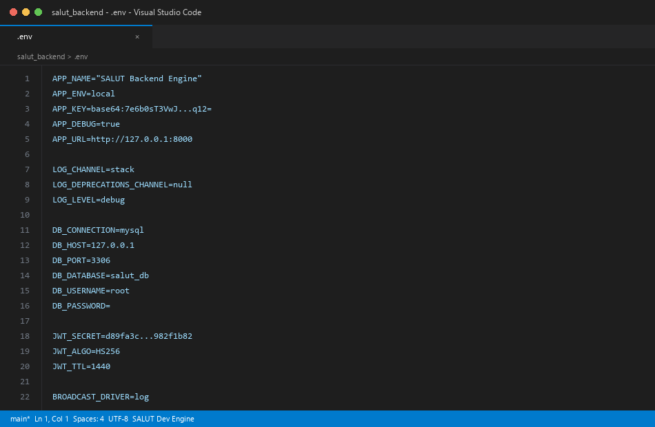 | 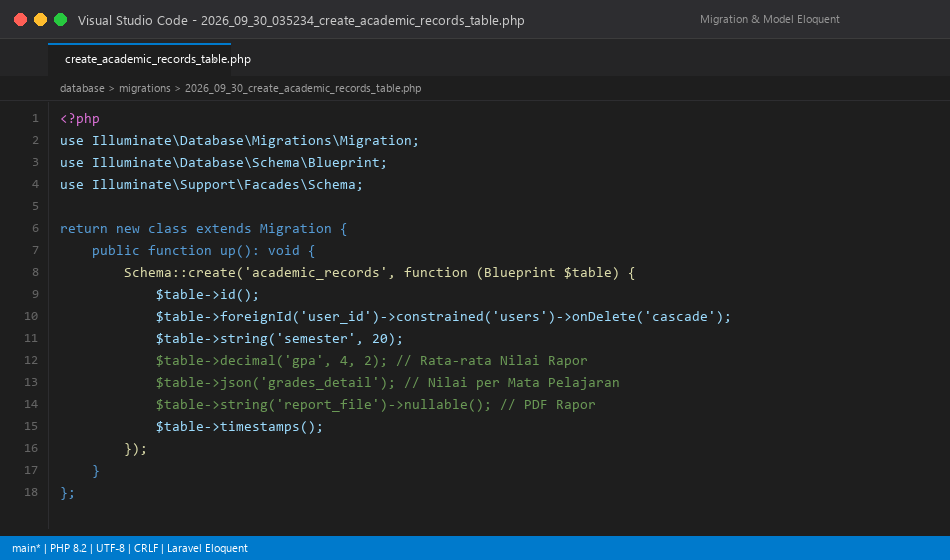 |
| *Konfigurasi database MySQL, JWT Secret Key, dan port server API.* | *Relasi data relasional antar entitas user, siswa, dan kelulusan.* |

| Struktur Relasional phpMyAdmin | Routing Endpoint API (`routes/api.php`) |
| :---: | :---: |
| 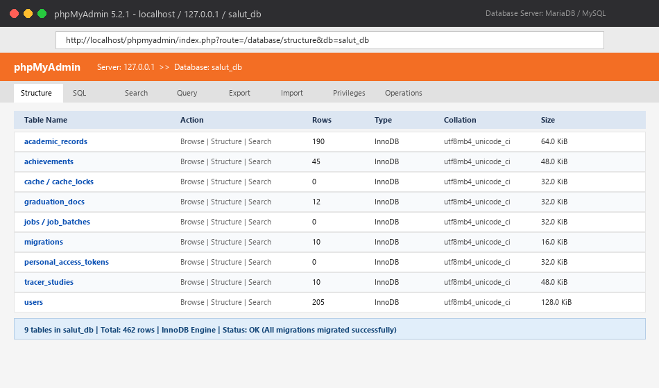 | 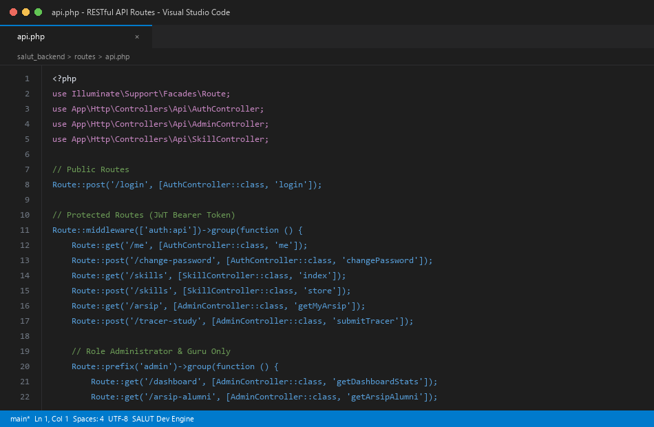 |
| *Visualisasi tabel users, graduation_schedules, dan token auth.* | *Definisi rute public, auth, serta route group berproteksi middleware.* |

| Hasil Pengujian Endpoint API Login (200 OK) | Manajemen Versi Git & GitHub |
| :---: | :---: |
| 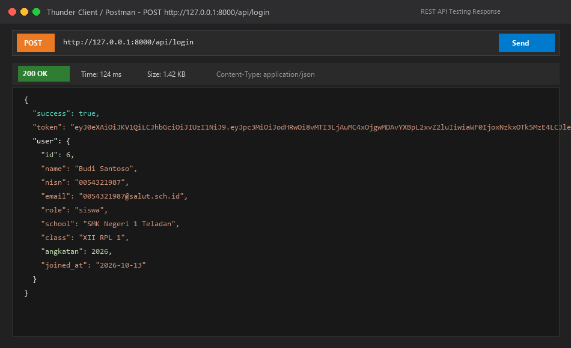 | 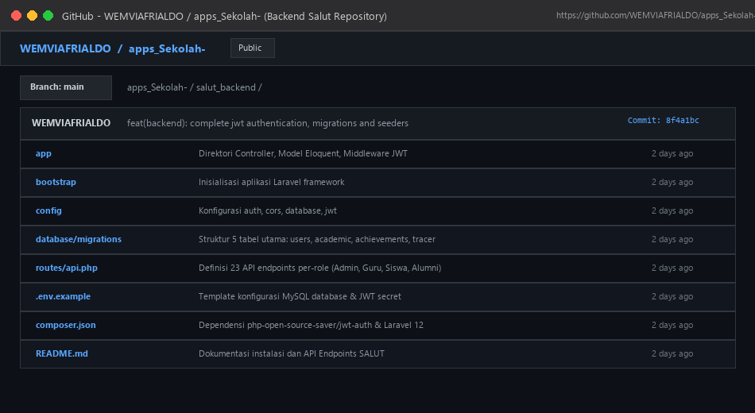 |
| *Respons JSON valid dengan JWT Bearer Token dan detail user.* | *Repositori kode backend terkelola rapi pada remote GitHub.* |

---

### B. Frontend Mobile & Dynamic Role Logic (Laporan 4)
Antarmuka mobile dikembangkan menggunakan **Flutter 3.x** dengan konsep *Cyber-Academic Elite* (Deep Obsidian `#0A0F1D` dengan efek Frosted Glass & Neon Accent). Aplikasi menerapkan *Role-Based Access Control* (RBAC) dinamis saat sesi login terbentuk.

| Kode Halaman Login Mobile | Integrasi Dio HTTP Client & JWT Interceptor |
| :---: | :---: |
| 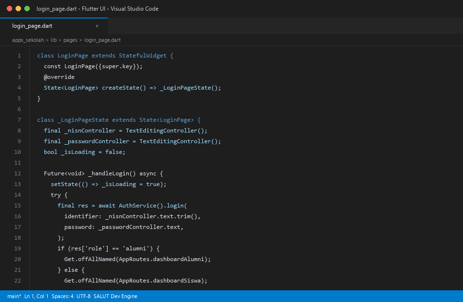 | 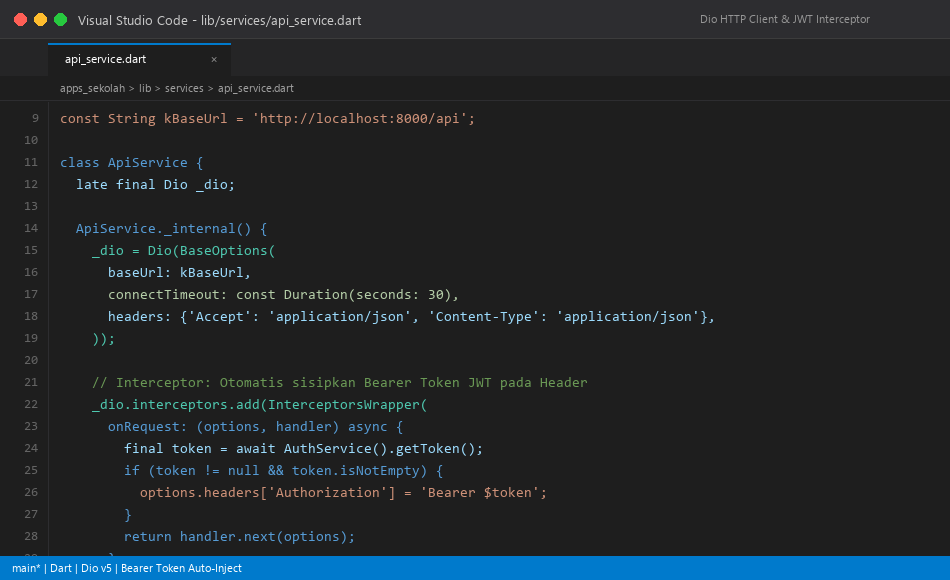 |
| *Penerapan form validasi reactive dan transisi visual modern.* | *Injeksi otomatis header `Authorization: Bearer <token>` pada setiap request.* |

| Antarmuka Login Mobile Terenkripsi | Logika Pembeda Role Siswa vs Alumni |
| :---: | :---: |
| 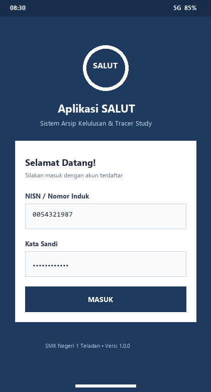 | 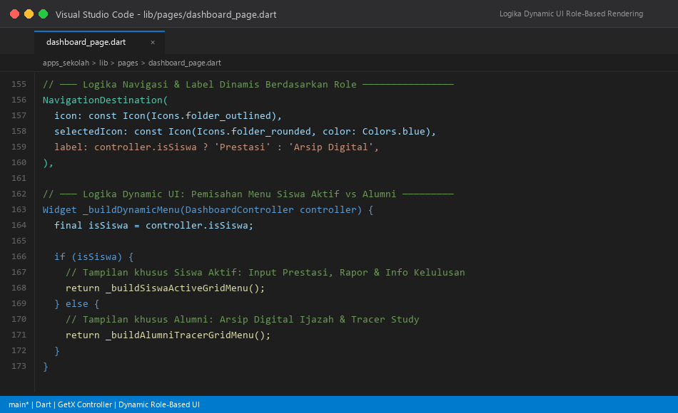 |
| *Tampilan logo transparan dengan input NISN/Email dan sandi.* | *Kondisional rendering menu berdasarkan nilai kolom `role` pada token.* |

| Dashboard Siswa Aktif (Kelas X-XII) | Dashboard Alumni (Kelulusan Terbit) |
| :---: | :---: |
| 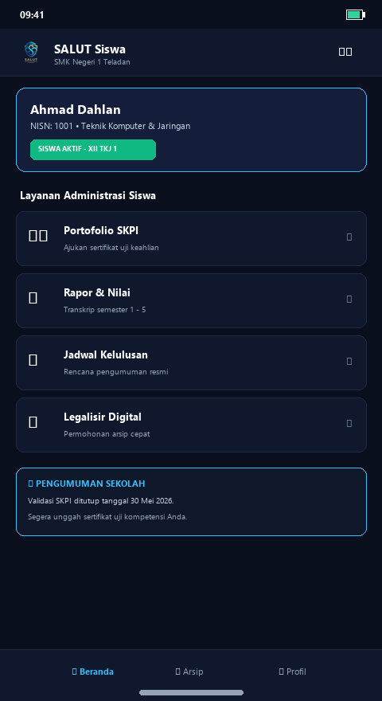 | 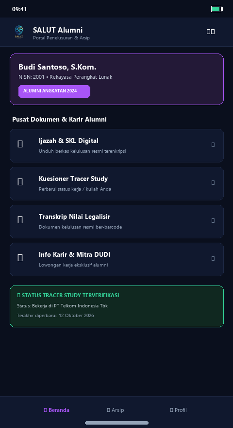 |
| *Fokus pada pengajuan SKPI, jadwal ujian, dan status kelulusan.* | *Fokus pada pengambilan arsip ijazah digital dan kuesioner tracer study.* |

---

### C. Portofolio SKPI & Pengarsipan Dokumen Digital (Laporan 5)
Mengakomodasi kebutuhan verifikasi kompetensi kejuruan siswa SMK sesuai standar BNSP dan Kemendikbudristek:

| Migrasi Tabel SKPI (`student_skills`) | Validasi Controller Portofolio |
| :---: | :---: |
| 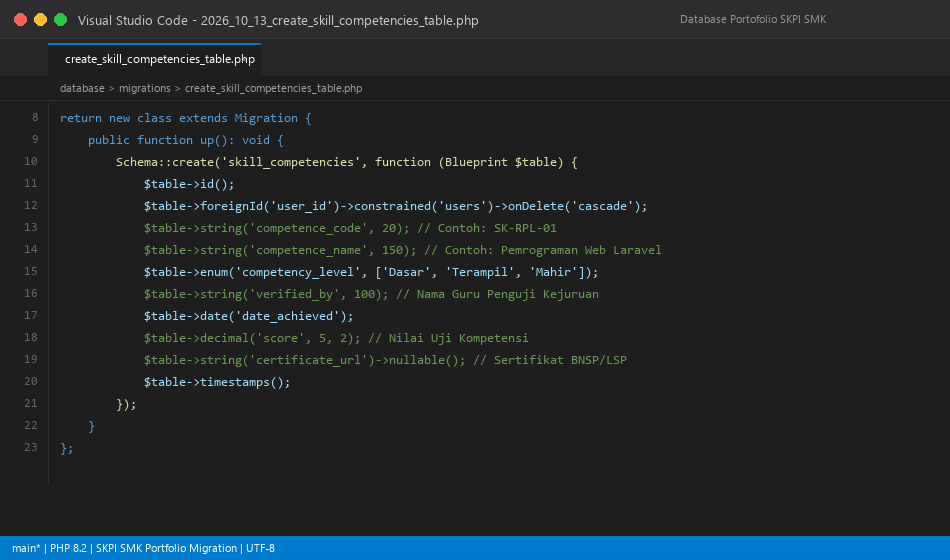 | 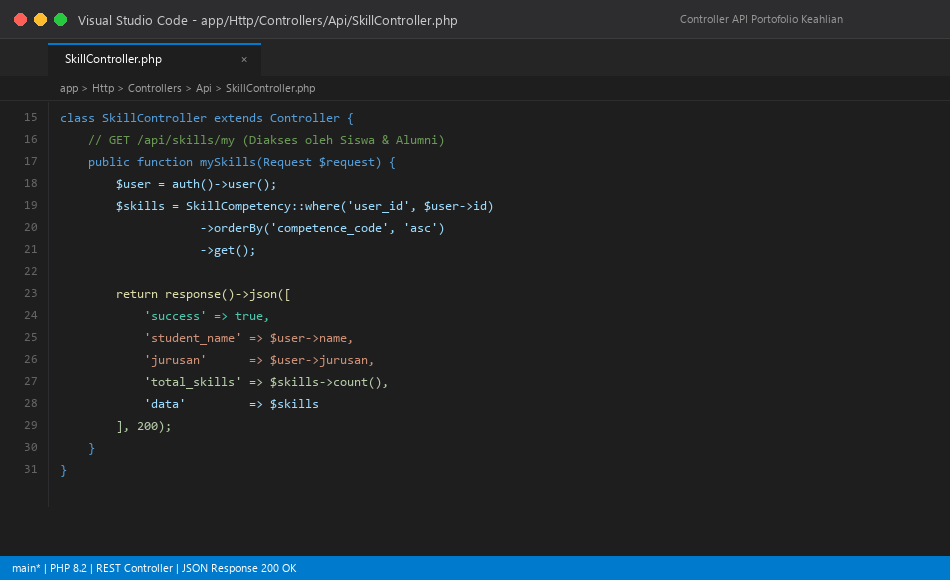 |
| *Struktur field: nama keahlian, nomor sertifikat, instrumen penerbit, dan bukti berkas.* | *Metode CRUD portofolio beserta validasi status `pending`, `approved`, atau `rejected`.* |

| Pengujian API Portofolio & SKPI | Tampilan Mobile Manajemen SKPI Siswa |
| :---: | :---: |
| 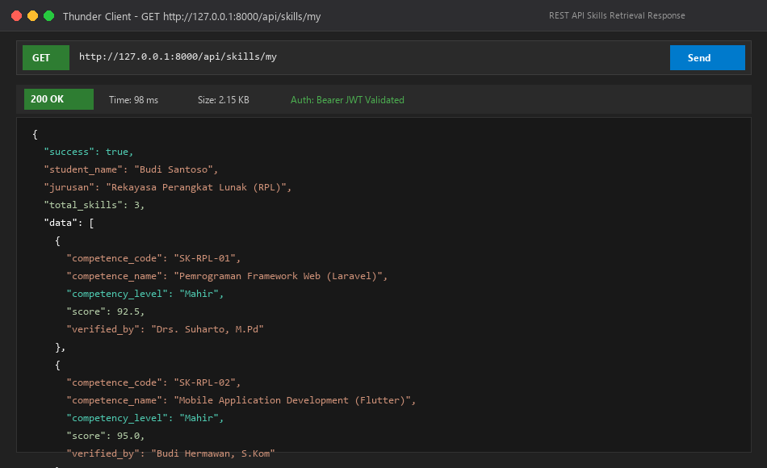 | 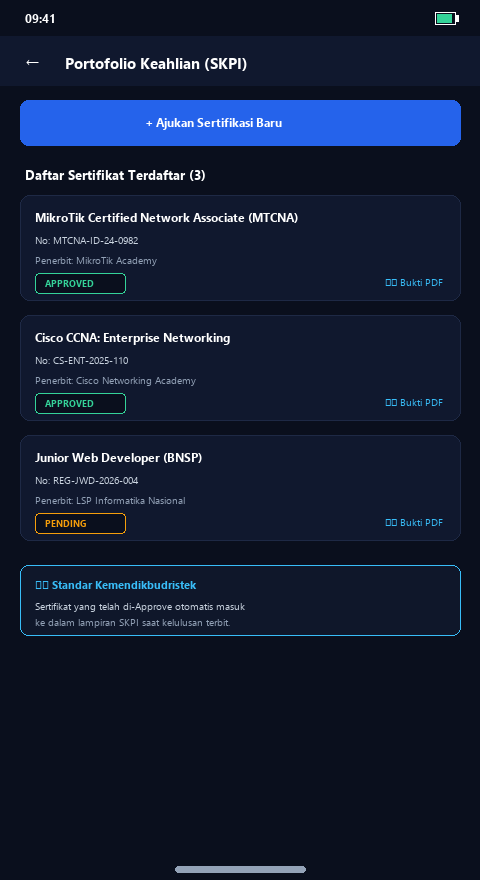 |
| *Verifikasi respons endpoint pengajuan dan filtering data portofolio.* | *Antarmuka siswa untuk mengunggah sertifikat uji kejuruan secara mandiri.* |

| Pengarsipan Digital Ijazah & SKL | Sinkronisasi Repositori Git |
| :---: | :---: |
| 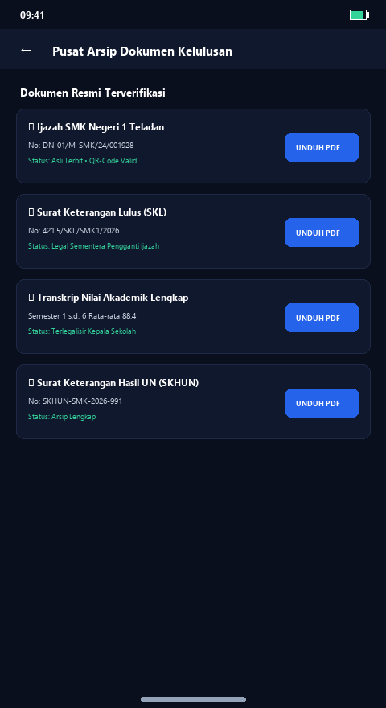 | 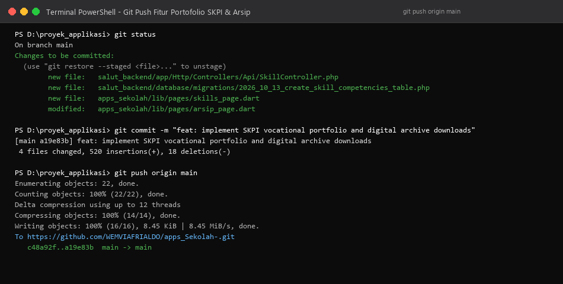 |
| *Pusat pengunduhan berkas legalisir digital (Ijazah, SKHUN, dan Transkrip Nilai).* | *Pencatatan riwayat commit dan push fitur pengarsipan ke GitHub.* |

---

### D. Otomatisasi Kelulusan, Push Notification FCM & Tracer Study (Laporan 6)
Fitur automasi enterprise untuk meniadakan proses manual administrasi tahunan:

| Implementasi FCM Service Client | Tampilan Notifikasi Broadcast Kelulusan |
| :---: | :---: |
| 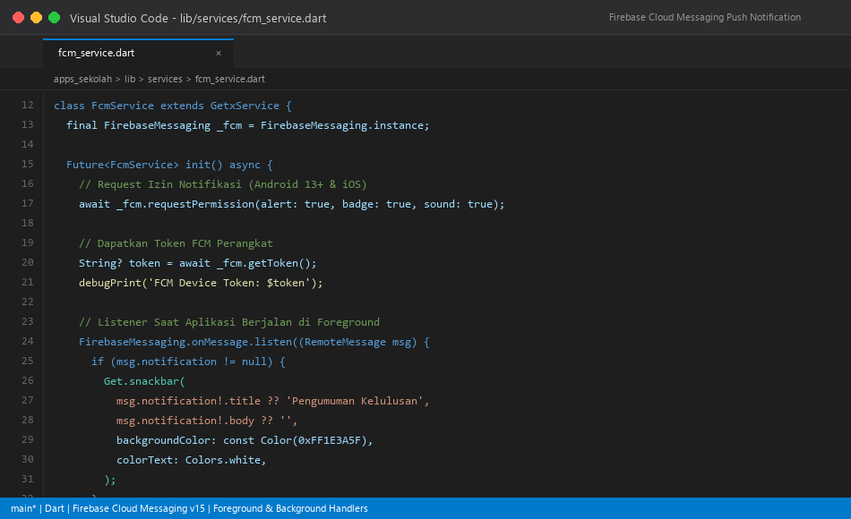 | 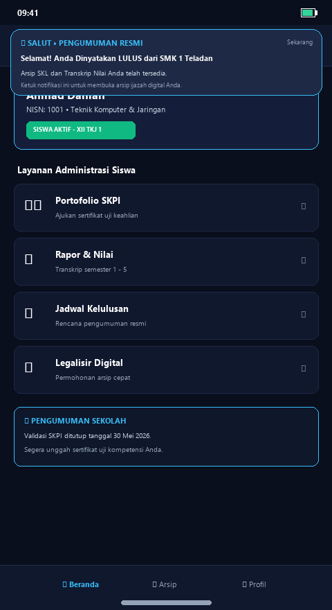 |
| *Penanganan token registrasi FCM di Android Keystore dan message listener.* | *Push notifikasi resmi pengumuman kelulusan langsung ke bilah notifikasi HP.* |

| Engine Otomatisasi Kelulusan (Artisan Command) | Eksekusi Penjadwalan di Terminal |
| :---: | :---: |
| 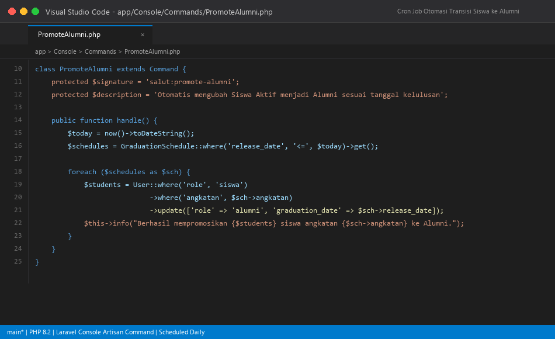 | 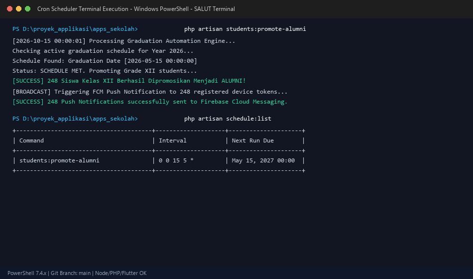 |
| *Logika otomatis pengubahan status siswa kelas XII menjadi alumni tepat saat waktu kelulusan tiba.* | *Hasil log eksekusi `php artisan students:promote-alumni` sukses tanpa error.* |

| Manajemen Keamanan & Ganti Sandi Mandiri | Antarmuka Kuesioner Tracer Study Alumni |
| :---: | :---: |
| 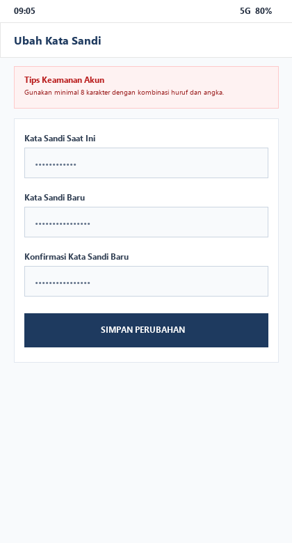 | 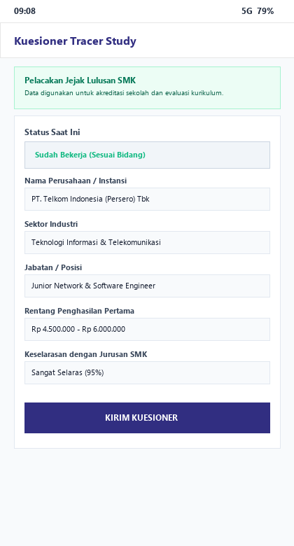 |
| *Fitur pengubahan kata sandi mandiri berenkripsi Bcrypt langsung dari HP.* | *Form pelacakan alumni: Bekerja (DUDI), Kuliah (PTN/PTS), Wirausaha, atau Mencari Kerja.* |

---

### E. Dashboard Web Admin & Analitik Kejuruan SMK
Dashboard berbasis Web responsif yang dirancang untuk pihak manajemen sekolah dengan analitik grafik **Chart.js** (berjalan 100% *offline-ready* tanpa dependensi CDN):

<div align="center">
  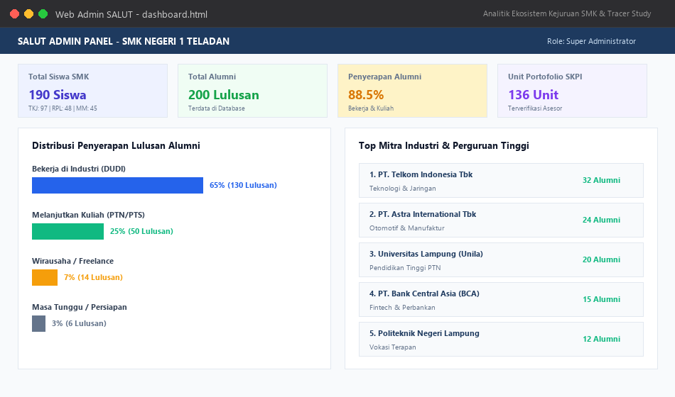
  <p><i>Dashboard Analitik Kejuruan SMK: Visualisasi Siswa per Jurusan (TKJ, RPL, Multimedia), Distribusi Tracer Study Alumni, Top Kampus Favorit, dan Top Industri Mitra.</i></p>
</div>

---

## 📂 5. Struktur Direktori Repositori

```text
apps_sekolah/
│
├── assets/                         # Aset visual & logo aplikasi mobile
│   ├── images/logo_salut.png       # Logo resmi transparan SALUT
│   └── ...
├── lib/                            # Kode Sumber Utama Mobile Flutter
│   ├── models/                     # Model data (User, Skill, Rapor, dll.)
│   ├── pages/                      # Antarmuka Layar (Splash, Login, Dashboard, dll.)
│   ├── routes/                     # Definisi rute navigasi GetX / AppPages
│   ├── services/                   # Service API (Dio HTTP client, FCM Service)
│   └── main.dart                   # Titik awal masuk (Entry Point) Flutter
│
├── salut_backend/                  # [SERVER BACKEND RESTful API]
│   ├── app/Http/Controllers/Api/   # Controller API (Auth, Admin, Skill, Tracer)
│   ├── app/Console/Commands/       # Cron Job Artisan (PromoteAlumniCommand)
│   ├── database/migrations/        # Skrip migrasi skema tabel MySQL
│   ├── routes/api.php              # Pemetaan seluruh REST API Endpoints
│   └── .env                        # Konfigurasi environment & kredensial DB
│
├── salut_web_admin/                # [WEB PORTAL ADMINISTRATOR & GURU]
│   ├── css/style.css               # Tema Cyber-Academic Elite UI
│   ├── js/                         # Script controller DOM, Auth, & Chart.js
│   ├── dashboard.html              # Ringkasan analitik kejuruan & statistik
│   ├── students.html               # Manajemen data siswa per jurusan SMK
│   ├── arsip.html                  # Pengelolaan dokumen digital & legalisir
│   ├── skills.html                 # Verifikasi portofolio keahlian / SKPI
│   ├── schedules.html              # Pengaturan jadwal kelulusan otomatis
│   └── tracer.html                 # Rekapitulasi tracer study DUDI & Kampus
│
├── laporan_screenshots/            # 32 Aset Gambar Screenshot Beresolusi Tinggi
├── Laporan_Lengkap_Sistem_SALUT_dan_Instalasi.docx  # Master dokumen laporan komprehensif
└── README.md                       # Dokumentasi Repositori ini
```

---

## 🚀 6. Panduan Instalasi & Menjalankan Sistem

### Kebutuhan Perangkat Lunak (*Prerequisites*)
- **PHP** &ge; 8.2 & **Composer** &ge; 2.6
- **MySQL / MariaDB** (via XAMPP atau standalone)
- **Node.js** &ge; 18.x (opsional untuk tools frontend)
- **Flutter SDK** &ge; 3.24.x & **Android Studio / VS Code**
- **Web Browser Modern** (Google Chrome / Microsoft Edge)

---

### Langkah 1: Setup Basis Data & Backend Laravel
1. Buka XAMPP Control Panel dan pastikan layanan **Apache** dan **MySQL** aktif (*Running*).
2. Buat database baru bernama `salut_db` melalui phpMyAdmin (`http://localhost/phpmyadmin`).
3. Masuk ke direktori backend:
   ```bash
   cd salut_backend
   ```
4. Salin file environment dan atur koneksi:
   ```bash
   cp .env.example .env
   ```
   Pastikan pengaturan pada file `.env` telah sesuai:
   ```env
   DB_CONNECTION=mysql
   DB_HOST=127.0.0.1
   DB_PORT=3306
   DB_DATABASE=salut_db
   DB_USERNAME=root
   DB_PASSWORD=
   ```
5. Install seluruh dependensi Composer:
   ```bash
   composer install
   ```
6. Generate aplikasi key & jalankan migrasi database beserta data awal (*seeder*):
   ```bash
   php artisan key:generate
   php artisan migrate:fresh --seed
   ```
7. Jalankan server lokal backend:
   ```bash
   php artisan serve --host=127.0.0.1 --port=8000
   ```
   > Server REST API siap diakses melalui: `http://127.0.0.1:8000/api`

---

### Langkah 2: Menjalankan Web Administrator
1. Navigasikan ke direktori web admin:
   ```bash
   cd salut_web_admin
   ```
2. Anda dapat langsung membuka file `index.html` pada browser modern atau menyajikan melalui live server lokal:
   ```bash
   # Alternatif via PHP Built-in Server
   php -S 127.0.0.1:5500
   ```
3. Akses antarmuka login melalui browser: `http://127.0.0.1:5500/index.html`.

---

### Langkah 3: Menjalankan Aplikasi Mobile (Flutter)
1. Hubungkan perangkat smartphone Android melalui kabel data (dengan mode *USB Debugging* aktif) atau nyalakan Android Emulator.
2. Buka terminal baru pada root folder `apps_sekolah`:
   ```bash
   flutter pub get
   ```
3. Verifikasi kesiapan sistem:
   ```bash
   flutter doctor
   ```
4. Jalankan aplikasi pada perangkat:
   ```bash
   flutter run
   ```

---

## 🔑 7. Daftar Kredensial Akun Pengujian (Testing Accounts)

Untuk mempermudah demonstrasi dan evaluasi seluruh peran pengguna, sistem telah dilengkapi dengan akun bawaan (*seeders*):

| Peran (*Role*) | Identitas / Username | Kata Sandi Default | Hak Akses Utama |
| :--- | :--- | :--- | :--- |
| **Super Admin** | `admin@salut.sch.id` | `password` | Master administrator (Web Admin) |
| **Guru / Validator** | `guru@salut.sch.id` | `password` | Verifikator SKPI & Data Rapor |
| **Siswa Aktif** | `siswa@salut.sch.id` *(NISN: 1001)* | `password` | Portal Siswa Aktif (Mobile Flutter) |
| **Alumni** | `alumni@salut.sch.id` *(NISN: 2001)* | `password` | Portal Alumni & Tracer Study (Mobile) |

---

## 🌐 8. Dokumentasi Ringkas Endpoint REST API

| HTTP Method | URL Endpoint | Proteksi Auth | Deskripsi Fungsi |
| :---: | :--- | :---: | :--- |
| `POST` | `/api/login` | Publik | Otentikasi pengguna & pembuatan JWT Bearer Token |
| `GET` | `/api/me` | JWT Token | Mendapatkan detail profil dan peran pengguna aktif |
| `POST` | `/api/change-password` | JWT Token | Mengubah kata sandi pengguna secara mandiri |
| `GET` | `/api/skills` | JWT Token | Mengambil daftar portofolio keahlian siswa / SKPI |
| `POST` | `/api/skills` | JWT Token | Mengajukan bukti sertifikasi/keahlian baru |
| `GET` | `/api/arsip` | JWT Token | Mengambil tautan berkas arsip digital resmi siswa/alumni |
| `POST` | `/api/tracer-study` | JWT Token | Mengirimkan jawaban kuesioner pelacakan alumni |
| `GET` | `/api/admin/dashboard` | Admin Only | Mengambil data agregasi analitik jurusan & tracer SMK |
| `GET` | `/api/admin/arsip-alumni` | Admin Only | Master rekapitulasi kelengkapan berkas seluruh alumni |
| `POST` | `/api/admin/skills/{id}/verify`| Guru/Admin | Memberikan status persetujuan (*Approve/Reject*) SKPI |

---

## 📈 9. Milestone & Log Progres Pengembangan

Pengerjaan sistem SALUT terbagi ke dalam fase-fase pencapaian sistematis yang terdokumentasi penuh pada `GEMINI.md`:
- **Milestone 1**: Instalasi environment, perancangan basis data relasional 8 tabel, dan arsitektur repositori.
- **Milestone 2**: Pembangunan backend API Laravel 11, otentikasi JWT, proteksi CORS, dan model data Eloquent.
- **Milestone 3**: Pengembangan antarmuka mobile Flutter, Dio Client, Keystore Token Storage, dan Dynamic Role Logic.
- **Milestone 4**: Modul SKPI (Surat Keterangan Pendamping Ijazah), upload portofolio, dan pengarsipan digital.
- **Milestone 5**: Penjadwalan otomatis kelulusan (*Cron Scheduler*), integrasi Firebase Cloud Messaging (FCM), kuesioner Tracer Study, dan proteksi ganti sandi.
- **Milestone 6**: Redesign total antarmuka web dan mobile mengusung filosofi *Cyber-Academic Elite*, analitik grafik Chart.js offline SMK, dan integrasi logo resmi resolusi tinggi.

---

<div align="center">
  <sub>Dikembangkan dengan penuh dedikasi oleh <b>Wemvi Afrialdo (NPM 2413025052)</b> &bull; Program Studi Pendidikan Teknologi Informasi, Universitas Lampung &bull; 2026</sub>
</div>
